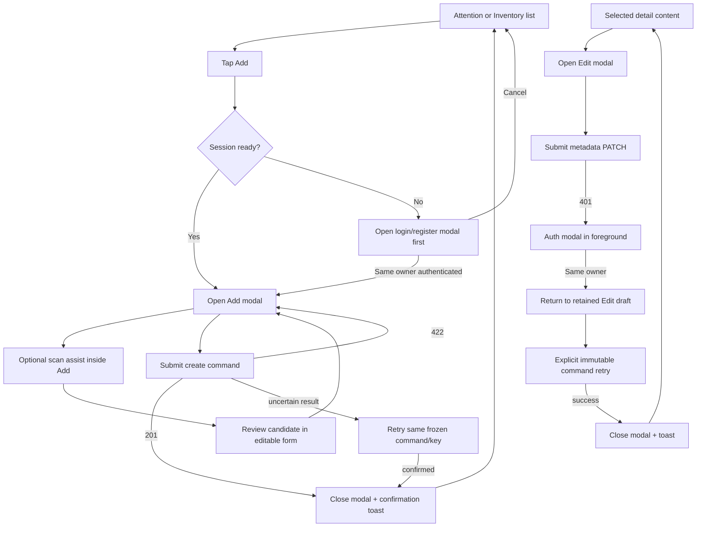

# DOC-NAV — Current application navigation and surface map

- Document ID: `DOC-NAV`
- Status: **Review**
- Updated: 2026-10-13

## Purpose

Describe the observed React shell, in-memory view state, page content, and modal transitions. This is a source-aligned interaction map, not a router proposal or product approval.

## Evidence sources

- [App view/session/modal owner](../../../apps/web/src/App.tsx)
- [Responsive shell navigation](../../../apps/web/src/components/layout/Shell.tsx)
- [Welcome onboarding](../../../apps/web/src/features/Welcome.tsx)
- [Entry form and scan assist](../../../apps/web/src/features/EntryForm.tsx)
- [Authentication form](../../../apps/web/src/features/AuthForm.tsx)
- [Schema input/output contract](../06-data-model/schema-input-output.md)
- [Bounded browser recovery evidence](../10-testing/schema-reconciliation-2026-10-13.md)

## Definitions and assumptions

**[A]** `App` owns `view`, selected entry, modal type, pending add/create intent, auth modal, and command recovery coordination. `Shell` owns responsive navigation controls. The current app initializes selected view/ID/modal from limited query parameters, but internal transitions use React state; a router/history contract is not implemented. **[A]** Real API mode and explicit demo mode are separate. Demo data is in-memory prototype behavior and is not private backend persistence.

## Analysis

### Current top-level screens and overlays

| Surface | Current owner/composition | Entry and primary transitions | Save/result behavior |
|---|---|---|---|
| Welcome/onboarding | `Welcome` before the shell when onboarding is not marked complete | Start marks started then requests Add; Skip enters shell; Demo switches URL to `?demo=1` | Not a private inventory screen; onboarding completion is stored in browser local storage |
| Attention list | `Shell` + `Inventory` with `view="attention"`; initial default | Bottom/side nav “Cần chú ý”; card opens selected detail; filter/search stays in list; Add action | Add requires authenticated session before form appears in real mode |
| Inventory list | `Shell` + `Inventory` with `view="inventory"` | Bottom/side nav “Kho”; card opens detail; filters stay in list; Add action | Successful create closes Add modal, refreshes through query owner, shows toast, and remains on the list; it does not automatically open detail |
| Trash | `Shell` + `Trash`, a distinct view from History | Bottom/side nav “Thùng rác”; Restore opens a confirmation dialog | Successful restore returns the entry to active inventory state; no movement event |
| Settings | `Shell` + `Settings` | Bottom/side nav “Cài đặt”; controls timezone and attention lead days; account row exposes logout when authenticated | Successful save stays on Settings and shows confirmation; logout clears selected/action/draft state |
| Selected entry detail | `Detail` replaces list content inside the shell while an entry is selected | Open from either list; breadcrumb/back clears selection; actions open modals | Not a separate URL; metadata edit result closes its modal and stays on the selected detail content |
| Add form | `EntryForm` modal over the current shell content | Authenticated Add opens it; unauthenticated Add opens Auth first and records pending Add intent; scan assist is nested and initially collapsed | Save creates entry plus initial movement; success closes modal and shows toast on same list |
| Edit / date form | `EntryForm` modal over selected detail; quantity and unit render read-only | Edit from detail; date action opens the date step | PATCH changes metadata/version only; success closes modal and returns to selected detail content |
| Movement form | `MovementForm` modal over selected detail or list context | Use, discard, or recount; requires explicit amount (or actual amount/reason for recount) | Success closes modal and updates visible quantity/attention; same-value recount is a no-op response without new movement |
| History | `History` modal for a selected entry | Open from detail; read-only timeline; close returns to detail | Shows movement events and recorded time; no edit/delete controls |
| Authentication | `AuthForm` modal over shell/form content | Account control, Add gate, or 401 reauthentication | Registration/login creates or restores session. Same-owner reauthentication restores access to the retained edit form; submitting its existing command is an explicit retry action |

Desktop shell uses side navigation; mobile shell uses bottom navigation with a center Add action. Changing top-level view clears selection and action state; changing to Inventory/Attention resets filters. The query string is read at initialization for supported `view`, `id`, `modal`, `started`, and `demo` values, but current in-app navigation does not establish canonical URLs or browser back/forward behavior.

### Current Add/auth and edit/recovery transitions

**[A]** Canceling the pending Add auth gate clears its pending intent and returns to the current shell view. When an already-submitted write needs authentication recovery, the app preserves the command’s owner, payload, and idempotency key; a changed identity clears private selection and pending command state. Recovery does not silently change an amount or create a new command.

## Decisions and rationale

**[A]** This document describes current source behavior rather than the earlier conceptual `Intro → Add → Gate` order: in real mode the auth gate precedes opening the Add form. Create success remains on the list with a toast; Edit success remains on selected detail content. History is a modal timeline and Trash is a separate shell view.

## Dependencies

- [Current user flows](../04-user-flows/user-flows.md)
- [Screen and recovery-state matrix](screen-state-matrix.md)
- [Current wireframe/interaction spec](08_Wireframes_and_Interaction_Spec.md)
- [Current app source](../../../apps/web/src/App.tsx)

## Open questions

No canonical URL, route-level deep link, browser history restoration, or unsaved-form navigation contract is established by the current React state. Those behaviors require explicit design and verification before being described as implemented.

## Related documents

- [Authentication contract](../07-api/authentication.md)
- [API operation input/output](../06-data-model/schema-input-output.md)
- [Sequence models](sequences.md)
- [Schema reconciliation report](../10-testing/schema-reconciliation-2026-10-13.md)

## Verification criteria

Surface ownership and transitions must correspond to the current `App`, `Shell`, and feature components. Browser-specific recovery claims are bounded to the dated report’s explicitly listed synthetic-401 observation; this map does not assert all-flow browser acceptance.
