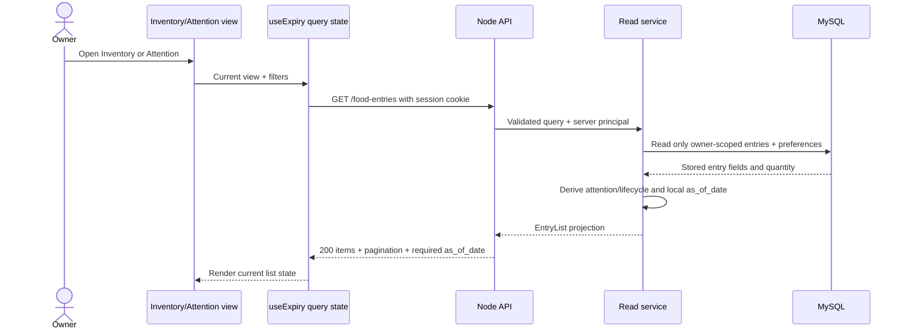
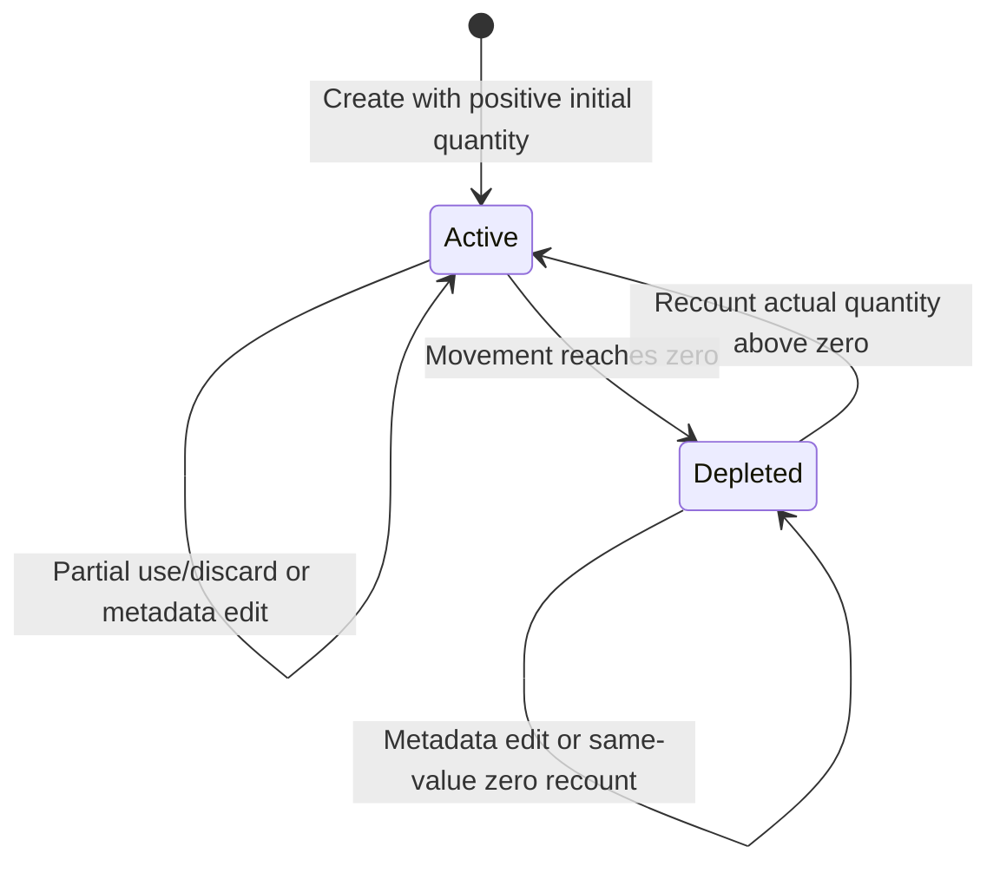

# DOC-SEQUENCES — Current UI/API/data sequences

- Document ID: `DOC-SEQUENCES`
- Status: **Review**
- Updated: 2026-10-13

## Purpose

Show ownership and feedback for the current Add/auth, edit-recovery, read, and quantity-mutation paths without conflating UI state, API contracts, and persisted state.

## Evidence sources

- [App command and modal transitions](../../../apps/web/src/App.tsx)
- [Entry form draft / scan application](../../../apps/web/src/features/EntryForm.tsx)
- [API adapter and command retry](../../../apps/web/src/api/client.ts)
- [Expiry data hook](../../../apps/web/src/hooks/useExpiry.ts)
- [MySQL migrations](../../../database/mysql/migrations/001_initial_schema.sql)
- [Bounded browser recovery observations](../10-testing/schema-reconciliation-2026-10-13.md)

## Definitions and assumptions

**[A]** `App` owns screen/modal coordination; forms own draft state; the authenticated server principal owns user identity; MySQL transaction services own committed records and movement history. Browser recovery claims are limited to the synthetic-401 case recorded on 2026-10-13. **[D]** Diagrams are interaction models, not test results or product approvals.

## Analysis

### Add request and successful create

```mermaid
sequenceDiagram
  actor U as Owner
  participant Shell as App/Shell
  participant Auth as Auth modal
  participant Form as Add EntryForm
  participant API as Node API
  participant DB as MySQL transaction
  U->>Shell: Tap Add
  alt Session already valid
    Shell->>Form: Open Add modal
  else No session / auth required
    Shell->>Auth: Record pending Add; open auth first
    U->>Auth: Register or login
    Auth->>API: POST auth/register or auth/login
    API-->>Auth: AuthSession + session cookie
    Auth-->>Shell: Same owner authenticated
    Shell->>Form: Open Add modal
  end
  opt Optional scan assist
    U->>Form: Select image and request scan
    Form->>API: POST /scans with image + CSRF
    API-->>Form: Transient raw text and candidate object
    U->>Form: Review/select candidate and apply to draft
  end
  U->>Form: Submit name, quantity, unit, metadata
  Form->>API: POST /food-entries + client key + CSRF
  API->>API: Validate principal, DTO, key, domain rules
  API->>DB: Insert entry + initial movement + saved replay result
  DB-->>API: Commit
  API-->>Form: 201 Entry
  Form-->>Shell: Close Add modal
  Shell-->>U: Stay on current list + success toast
```

A successful server-mode create does not automatically select/open the new Detail view. The current list remains the visible task context and refreshes its data. Scan is a separate transient response; persistence happens only through the normal reviewed Add command. Explicit demo mode uses an in-memory adapter and is outside this server sequence.

### Metadata Edit and bounded synthetic-401 recovery

```mermaid
sequenceDiagram
  actor U as Owner
  participant Detail as Selected Detail
  participant Edit as Edit EntryForm
  participant Auth as Foreground Auth modal
  participant API as Node API
  participant DB as MySQL transaction
  U->>Detail: Tap Edit
  Detail->>Edit: Open form with current metadata
  Note over Edit: Quantity and unit are read-only
  U->>Edit: Change name/location and submit
  Edit->>API: PATCH /food-entries/{id} + expected_version + key + CSRF
  alt Success
    API->>DB: Update allowed metadata/version only
    DB-->>API: Commit
    API-->>Edit: 200 Entry
    Edit-->>Detail: Close modal; retain selected Detail
    Detail-->>U: Updated metadata + confirmation toast
  else Synthetic 401 observed in bounded browser check
    API-->>Edit: 401 Problem
    Edit->>Auth: Keep draft mounted; foreground auth
    U->>Auth: Login as same owner
    Auth->>API: POST /auth/login
    API-->>Auth: Same owner session restored
    Auth-->>Edit: Close auth overlay; retain Edit draft
    U->>Edit: Explicitly choose immutable Retry
    Edit->>API: Retry original frozen command/key
    API->>DB: Apply metadata/version only
    DB-->>API: Commit
    API-->>Edit: 200 Entry
    Note over DB: Quantity remains unchanged (browser observation: 500)
  end
```

**[A] Bounded browser observation:** after a synthetic 401, login was reachable in the foreground; the same-owner Edit draft’s name/location remained; the in-modal immutable Retry was reachable and applied only metadata; quantity stayed 500. This is one recovery scenario, not all-flow browser acceptance. A separate bounded lost-response discard observation is recorded in the reconciliation report; it does not establish exact real-world timeout timing.

### Inventory read and attention projection



Classification and sorting must be applied to the eligible query result before pagination. `attention` and `lifecycle` are derived response values, not persisted columns. UI filters do not change ownership or the server’s private boundary.

### Quantity movement / recount transaction

```mermaid
sequenceDiagram
  actor U as Owner
  participant Form as MovementForm
  participant API as Node API
  participant Tx as Mutation executor
  participant DB as MySQL transaction
  U->>Form: Confirm use/discard or recount
  Form->>API: POST movement/recount + expected_version + client key + CSRF
  API->>Tx: Valid principal and DTO
  Tx->>DB: Begin and reserve/replay owner-scoped key
  Tx->>DB: Lock owned, nondeleted entry FOR UPDATE
  DB-->>Tx: Current quantity/version
  Tx->>Tx: Check version, finite decimal bounds, unit and action rules
  alt Invalid or stale
    Tx->>DB: Roll back
    Tx-->>API: 409 or 422 Problem
    API-->>Form: Keep draft and show feedback
  else Changed command
    Tx->>DB: Update quantity/version + append movement + save response
    Tx->>DB: Commit
    Tx-->>API: Entry + Movement + changed=true
    API-->>Form: 201 result
  else Same-value recount
    Tx-->>API: Entry + movement=null + changed=false
    API-->>Form: 200 no-op result
  end
  Form-->>U: Close on success; refresh quantity/history/attention
```

A movement retry with the same key/fingerprint replays the original result. A changed draft is a new command only after conflict/result resolution. Delete and restore change `deleted_at`/visibility and do not add movement rows.

### Entry quantity lifecycle (separate from visibility and attention)



Soft delete/restore is an independent visibility flag. Attention is an independent derived projection. Neither is represented as a state transition that changes quantity.

## Decisions and rationale

**[A]** The former Add sequence ended at “Saved detail”, which contradicted `App.create`: success closes Add, shows a toast, and leaves the list visible. The corrected sequence puts auth before opening Add in real mode and models Edit 401 as foreground authentication over a retained form. All recovery claims are bounded to the single browser observation listed above.

## Dependencies

- [Current navigation map](navigation.md)
- [Current screen recovery matrix](screen-state-matrix.md)
- [API input/output map](../06-data-model/schema-input-output.md)
- [Testing catalog](../10-testing/test-catalog.md)

## Open questions

Broad browser flows remain unverified; the bounded lost-response discard case is recorded separately in the reconciliation report. Router/history restoration is not implemented by these sequences. Database transaction descriptions reflect current source/schema evidence and do not imply production readiness.

## Related documents

- [Use cases](../04-user-flows/use-cases.md)
- [Data ownership and flows](../06-data-model/data-flows.md)
- [Schema reconciliation report](../10-testing/schema-reconciliation-2026-10-13.md)

## Verification criteria

Current success/failure results and state owners should match source handlers, API contract, and migrations. The browser proof cited for synthetic 401 must remain separately scoped; do not turn it into a full-flow claim.
