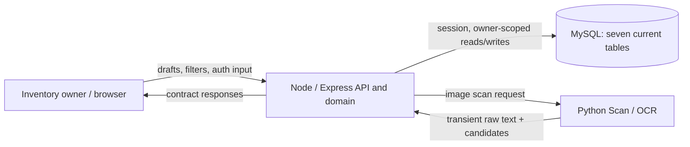

# DOC-DFD — Logical data movement and stores

- Document ID: `DOC-DFD`
- Status: **Review**
- Updated: 2026-10-09T18:37:36+07:00

## Purpose

DFD context, level 0/1 and flow-to-data/CRUD relationships.

## Evidence sources

- [00-context/source-register.md](../00-context/source-register.md)

## Definitions and assumptions

[C] Các proposal dưới đây cần review trước implementation; không có nhãn Approved trong lần authoring này.

## Analysis

**[A] Current data boundary:** browser forms hold uncommitted drafts; Node/Express validates identity and API commands; MySQL persists seven tables; Python Scan returns transient OCR text/candidates and has no MySQL write path. `App`/query hooks refresh visible list/detail after confirmed commands. Attention/lifecycle are projections, not stored states.

| Stage | Capture / create | Read / attention | Quantity correction | Identity/preferences |
|---|---|---|---|---|
| Input | Reviewed EntryCreate draft, valid principal, client idempotency key, CSRF header | Query/filter + session principal | Amount or actual quantity/reason + expected version + key | Email/password for local auth; timezone/lead days for preferences |
| Process | Validate DTO/domain, derive owner from session, reserve/replay key | Validate query and owner scope, derive attention from date/settings/clock | Replay check, lock owned row, validate version/unit/amount | Verify credential, create/revoke session; validate owner preference patch |
| State | `food_entries` + initial `stock_movements` + `api_requests` in one transaction | Reads `users` preferences + owned entries; no attention write | Update entry quantity/version, append movement if changed, record replay result atomically | `local_credentials`, `user_sessions`; preferences in `users`; `api_requests` for preference writes |
| External/process boundary | No autonomous OCR persistence; scan is a separate explicit assist | No scheduled/push write | No command before explicit user confirm | Node owns local auth; no external auth provider is implied |
| Output | `Entry` response | `EntryList` with required `as_of_date`, including empty list | Updated entry/movement; recount no-op returns `changed:false`, `movement:null` | `AuthSession`, preferences response, or Problem |
| UI feedback | Close Add modal, remain on same list, show success toast | Render owned results/reasons; details open from list | Close action, refresh detail/list/history | Add is opened only after session; same-owner command recovery preserves frozen command for explicit retry |

### Context boundary



This flow is not a login-provider integration. Local credentials and session persistence are inside the Node/MySQL boundary. Python Scan is a supporting service and returns candidates; it does not create food entries, movements, or labeled training rows.

### Current Level-0 process and stores

```mermaid
flowchart TD
  U["Authenticated owner / browser"] -->|"reviewed draft + key"| P1["1. Create entry"]
  U -->|"filters / entry ID"| P2["2. Read inventory and attention"]
  U -->|"command + version + key"| P3["3. Move / recount / metadata / delete / restore"]
  U -->|"preferences"| P4["4. Update preferences"]
  U -->|"credentials / login / logout"| P5["5. Authenticate and manage session"]
  D1[("D1 users / preferences")] --> P2
  P4 <-->|"read/update"| D1
  P1 -->|"entry + initial event"| D2[("D2 food_entries")]
  P1 -->|"initial movement"| D3[("D3 stock_movements")]
  P2 -->|"owner-scoped query"| D2
  P2 -->|"history query"| D3
  P3 <-->|"read/update quantity/version/visibility"| D2
  P3 -->|"append event when quantity changes"| D3
  P1 <-->|"reserve/replay result"| D4[("D4 api_requests")]
  P3 <-->|"reserve/replay result"| D4
  P4 <-->|"preference command result"| D4
  P5 <-->|"verify local credential"| D5[("D5 local_credentials")]
  P5 <-->|"create/check/revoke session"| D6[("D6 user_sessions")]
  Runner["Migration runner"] -->|"applied version, checksum, time"| D7[("D7 schema_migrations")]
  D7[("D7 schema_migrations") -.->|"runner metadata only; outside request flow"| P5]
  P1 -->|"created entry result"| U
  P2 -->|"items + reasons + as_of_date"| U
  P3 -->|"confirmed command result"| U
  P4 -->|"updated preferences"| U
  P5 -->|"AuthSession / 204"| U
```

`schema_migrations` is an operational table shown for completeness and is not a runtime dependency of the authentication process; it belongs to the migration runner. Domain writes to entries, movement history, and idempotency results share a transaction. Auth writes credentials/sessions according to the auth service; neither password nor raw bearer token is exposed as a food field.

### Flow-to-data matrix

| Flows | Read / input | Derived | Persisted | User result |
|---|---|---|---|---|
| UF-01/02 create | Entry fields; quantity/unit; optional date/metadata; session-derived principal | Validation and default normalization | `food_entries` + initial `stock_movements` + `api_requests` | Modal closes; list remains; success toast |
| UF-03/04 review | Owner entries, preferences, filters | Attention/lifecycle/as-of-date | None | Reasoned list/detail; user chooses next action |
| UF-05/06/07 quantity | Kind/amount or actual quantity/reason, expected version, key | Before/after/delta; no-op versus correction | `food_entries` + `stock_movements` when changed + `api_requests` | Confirmed amount/history refresh |
| UF-08 metadata | Allowed metadata patch/version/key | Merged date-state validation; attention recompute | `food_entries` + `api_requests`; no movement | Modal closes; selected Detail remains |
| UF-09 visibility | Delete/restore intent, version/key | Visibility state | `food_entries` + `api_requests`; no movement | List/Trash refresh and confirmation |
| UF-10 preferences | Timezone/lead/version/key | Local date and attention projection | `users` + `api_requests` | Settings remains visible with confirmation |
| UF-11 identity recovery | Registration/login credentials or existing frozen command | Principal/session continuity | `local_credentials`/`user_sessions`; domain row only if separately submitted/retried | Auth gate before Add; same-owner reauth returns to form |
| Scan assist | Explicit image request | Transient OCR text and candidates | None | Person reviews candidate before regular create submit |

| UC | users | food_entries | stock_movements | api_requests | local_credentials | user_sessions | schema_migrations |
|---|---|---|---|---|---|---|---|
| UC-00 auth/continuation | R | — | — | — | R/C | R/C/U | — |
| UC-01 create | R | C | C initial | C/R/U | — | R principal | — |
| UC-02/03 review | R | R | — | — | — | R principal | — |
| UC-04/05 movement | R | R/U | C | C/R/U | — | R principal | — |
| UC-06 edit | R | R/U | — | C/R/U | — | R principal | — |
| UC-07 recount | R | R/U | C if changed | C/R/U | — | R principal | — |
| UC-08 history | R | R owner check | R | — | — | R principal | — |
| UC-09/10 delete/restore | R | R/U | — | C/R/U | — | R principal | — |
| UC-11 preferences | R/U | — | — | C/R/U | — | R principal | — |

C=create, R=read, U=update. No public hard-delete of history or replay records is represented. Migration metadata is written only by the migration runner. OCR sample storage/training is not part of the current data flow.

## Decisions and rationale

[D] Giữ phạm vi food inventory cá nhân, manual capture và attention trong app theo source context. Approval kỹ thuật là riêng với việc kiểm tra cấu trúc tài liệu.

## Dependencies

- [09-user-flows/user-flows.md](../04-user-flows/user-flows.md)
- [06-data-model/erd-workbench/04_RELATIONSHIP_MATRIX.md](erd-workbench/04_RELATIONSHIP_MATRIX.md)
- [06-data-model/dictionary.md](../06-data-model/dictionary.md)

## Open questions

Chốt các quyết định liên quan trong decision ledger trước khi đổi contract hoặc triển khai.

## Related documents

- [README.md](../README.md)
- [11-traceability/README.md](../11-traceability/README.md)
- [04-user-flows/user-flows.md](../04-user-flows/user-flows.md)
- [06-data-model/erd-workbench/04_RELATIONSHIP_MATRIX.md](erd-workbench/04_RELATIONSHIP_MATRIX.md)
- [06-data-model/dictionary.md](../06-data-model/dictionary.md)

## Verification criteria

Đối chiếu nguồn, ID và downstream links; acceptance runtime chỉ được ghi pass sau khi thực chạy.

## Current source alignment — 2026-10-13 [A]

The active DFD now includes all seven current MySQL stores and the local-auth boundary. Scan remains transient; no OCR sample/training data is written. Empty list responses carry owner-local `as_of_date`; operation fields/defaults are mapped in [schema input/output](schema-input-output.md).
