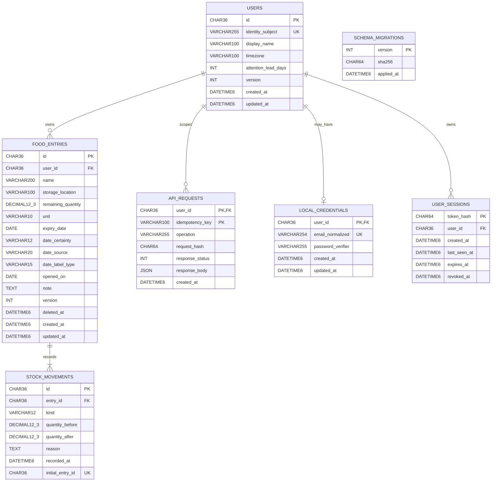

# DOC-ERD — Current MySQL logical/physical ERD

- Document ID: `DOC-ERD`
- Status: **Review**
- Updated: 2026-10-13

## Purpose

Show the current migration-backed seven-table MySQL model, ownership edges, and the difference between persisted state and derived API values.

## Evidence sources

- [Current MySQL logical ERD](erd-workbench/02_LOGICAL_ERD.mmd)
- [Current MySQL entity dictionary](erd-workbench/03_ENTITY_DICTIONARY.md)
- [Migration 001: core inventory](../../../database/mysql/migrations/001_initial_schema.sql)
- [Migration 002: local authentication](../../../database/mysql/migrations/002_local_auth.sql)
- [Current schema input/output mapping](schema-input-output.md)

## Definitions and assumptions

**[A]** The current development schema is MySQL 8.4/InnoDB and is represented by immutable migrations 001 and 002. IDs use `CHAR(36)` with ASCII binary collation. Quantity uses `DECIMAL(12,3)`. Timestamps use `DATETIME(6)` under the application’s UTC policy. `JSON` is used for the saved replay response. This document remains Review; it does not grant product or security approval.

## Analysis

The model contains **7 tables / 53 columns / 5 foreign keys**. The five FK constraints are `food_entries.user_id → users.id`, `stock_movements.entry_id → food_entries.id`, `api_requests.user_id → users.id`, `local_credentials.user_id → users.id`, and `user_sessions.user_id → users.id`; all use `RESTRICT` for delete/update. `schema_migrations` is migration-runner metadata and has no FK. The generated `stock_movements.initial_entry_id` is nullable and unique, enforcing at most one initial movement per entry. The service transaction supplies the corresponding create-time invariant that an entry is committed with its initial movement.

| Relationship | Cardinality | Persisted invariant / owner boundary |
|---|---|---|
| `users` → `food_entries` | User 0..N; each entry exactly 1 user | `food_entries.user_id` is immutable and server-derived from the authenticated principal; owner-scoped reads and writes |
| `food_entries` → `stock_movements` | Entry 1..N after create commit; each movement exactly 1 entry | Initial movement is atomic with create; later movements are append-only quantity history |
| `users` → `api_requests` | User 0..N; each command result exactly 1 owner | Composite primary key `(user_id, idempotency_key)` scopes replay; payload fingerprint prevents key reuse with different command |
| `users` → `local_credentials` | User 0..1 local credential row; each credential exactly 1 user | Normalized email and password verifier are private auth data; verifier is never returned by API |
| `users` → `user_sessions` | User 0..N; each session exactly 1 user | Only token hash is persisted; expiry/revocation gate private requests |
| `schema_migrations` | Independent migration ledger | Runner records version/hash/time after applying migration file; not a domain entity and not user-owned |

`attention` and `lifecycle` are response projections, not persisted columns. Attention is derived from the owner-local `as_of_date`, date metadata, quantity, and preferences. `lifecycle` is derived from remaining quantity. Soft-delete visibility is separately stored in `food_entries.deleted_at`; delete/restore is not a quantity movement. No household, shared catalog, OCR sample, or training table exists in these migrations.

## Decisions and rationale

**[A]** This diagram now follows the checked-in MySQL migrations and current native logical ERD, including local authentication and migration metadata. Physical types are shown because the task is reconciling current persisted state; APIs still expose UUIDs as strings, decimal quantities as strings, and UTC-formatted timestamps through an adapter policy.

## Dependencies

- [Current entity dictionary](dictionary.md)
- [Native ERD and database evidence](erd-workbench/README.md)
- [Schema input/output guide](schema-input-output.md)

## Open questions

The HTTP timestamp adapter’s explicit timezone serialization policy and future retention/cleanup policy for idempotency rows require separate decisions. No table is proposed here for OCR training data; that bounded candidate is separately documented for review only.

## Related documents

- [MySQL migrations and entities](entities-and-migrations.md)
- [Current native logical ERD](erd-workbench/02_LOGICAL_ERD.mmd)
- [Current physical dictionary](erd-workbench/03_ENTITY_DICTIONARY.md)
- [Schema reconciliation report](../10-testing/schema-reconciliation-2026-10-13.md)

## Verification criteria

The table/column/FK counts and types above must match both immutable migrations. Run the docs semantic validator for references; use the database evidence report for bounded sandbox-schema verification. A passing documentation check is not production database or product acceptance.
