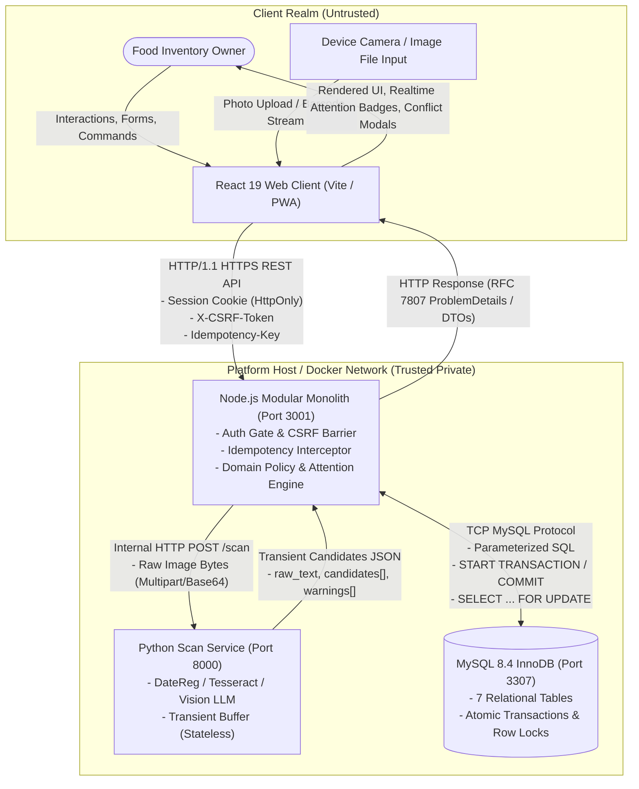
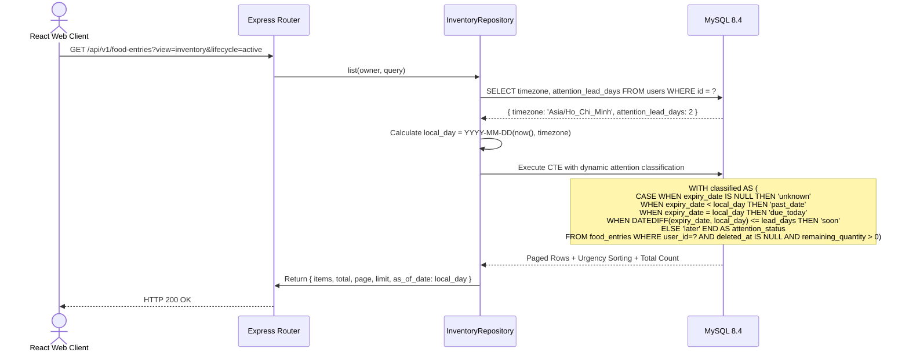
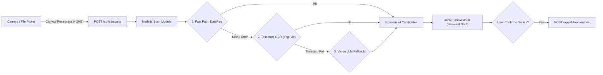
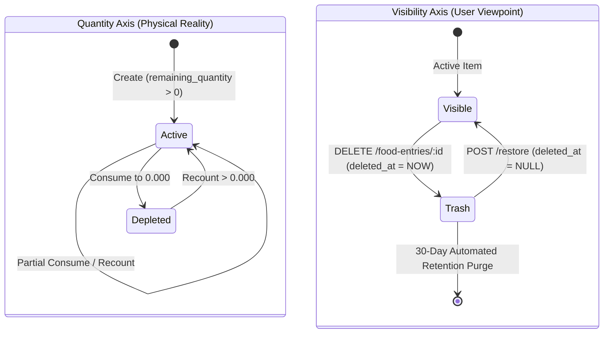

# DOC-DFD-RUNTIME — Runtime Architecture Data Flow Specification

- **Document ID**: `DOC-DFD-RUNTIME`
- **Status**: **Approved for Runtime Reality**
- **Aligned Branch**: `feature/barcode` (develop baseline)
- **Updated**: 2026-10-19
- **Authority**: Supersedes historical static DFD drafts; incorporates MySQL 8.4 migration 003 (barcode support), DateReg/Tesseract/Vision extraction pipelines, and the 7 persistent stores.

---

## 1. System Context & External Boundary (DFD Level-0)

The system context delineates the trust and process boundaries between the client, backend modular monolith, auxiliary OCR container, and persistent database.



### Boundary Security & Invariants
1. **Zero External Access to MySQL**: MySQL 8.4 listens exclusively on the loopback / internal Docker bridge network (`127.0.0.1:3307`). Neither the React client nor Python Scan has access credentials or direct TCP access to database ports.
2. **Stateless OCR Boundary**: The Python Scan service possesses **zero** database connection parameters. It processes images in a transient memory buffer and immediately frees memory without disk persistence.
3. **Session vs Caller Header Authority**: Caller identity headers (`X-User-Id`, etc.) are completely disregarded. The authenticated principal is exclusively unpacked from the server-signed `session_id` cookie against `user_sessions`.

---

## 2. Subsystem Data Flow Decomposition (DFD Level-1)

DFD Level-1 decomposes the core runtime processes and maps data movement against the 7 database stores:

```mermaid
flowchart TD
    User(["Authenticated Owner"])

    subgraph Processes ["Node.js Modular Processes"]
        P1["1.0 Authentication & Session Manager"]
        P2["2.0 Assistive OCR & Barcode Intake"]
        P3["3.0 Food Entry Ingestion & Version Control"]
        P4["4.0 Stock Movement & Recount Engine"]
        P5["5.0 Attention Projection & Expiry Scheduler"]
        P6["6.0 Trash Lifecycle & Retention Controller"]
        P7["7.0 Idempotency & Replay Cache Engine"]
    end

    subgraph DataStores ["MySQL 8.4 Persistent Stores"]
        D1[("D1: users\n(timezone, lead_days, version)")]
        D2[("D2: local_credentials\n(email_normalized, password_verifier)")]
        D3[("D3: user_sessions\n(token_hash, last_seen_at, expires_at)")]
        D4[("D4: food_entries\n(quantity, expiry_date, barcode, version)")]
        D5[("D5: stock_movements\n(kind, before, after, reason)")]
        D6[("D6: api_requests\n(idempotency_key, hash, response)")]
        D7[("D7: schema_migrations\n(version, checksum, applied_at)")]
    end

    %% Process 1: Auth
    User -->|"Email, Password, Logout"| P1
    P1 <-->|"Verify credentials"| D2
    P1 <-->|"Store / refresh / revoke session"| D3
    P1 -->|"Principal Context (req.owner)"| P3
    P1 -->|"Principal Context (req.owner)"| P4
    P1 -->|"Principal Context (req.owner)"| P5
    P1 -->|"Principal Context (req.owner)"| P6

    %% Process 2: Scan
    User -->|"Image Upload / Barcode String"| P2
    P2 -.->|"No DB Writes (Transient Extraction)"| D4
    P2 -->|"Structured Draft Suggestions"| User

    %% Process 7: Idempotency
    User -->|"Mutation Request + Idempotency-Key"| P7
    P7 <-->|"Reserve key / Replay cached response"| D6
    P7 -->|"Unreserved Mutation"| P3
    P7 -->|"Unreserved Mutation"| P4
    P7 -->|"Unreserved Mutation"| P6

    %% Process 3: Ingestion
    P3 -->|"Insert new entry (version=1)"| D4
    P3 -->|"Insert baseline 'initial' event"| D5

    %% Process 4: Movements & Recounts
    P4 <-->|"Lock row & update remaining_quantity"| D4
    P4 -->|"Append movement audit record"| D5

    %% Process 5: Read & Attention
    P5 <-->|"Read user timezone & lead days"| D1
    P5 <-->|"Read active entries & calculate dynamic urgency"| D4
    P5 -->|"Classified inventory with as_of_date"| User

    %% Process 6: Trash
    P6 <-->|"Mark deleted_at = NOW() / NULL"| D4
```



---

## 3. Granular Data Pathways (DFD Level-2)

### Pathway A: Atomic Mutation & Idempotency Pipeline
This pathway governs all state-modifying requests (`POST /food-entries`, `PATCH`, `POST movements`, `POST recounts`, `POST restore`).

```text
Incoming HTTP Mutation (POST / PATCH / DELETE)
  │
  ├── 1. Idempotency Key Validation
  │     └─ Regex: /^[A-Za-z0-9_-]{8,100}$/
  │
  ├── 2. Deadlock-Resilient Execution Loop (Max 4 attempts)
  │     └─ START TRANSACTION (InnoDB)
  │          │
  │          ├── Step 2a: Idempotency Reservation
  │          │     INSERT INTO api_requests(user_id, idempotency_key, operation, request_hash)
  │          │     ├─ On ER_DUP_ENTRY:
  │          │     │    SELECT saved response WHERE user_id=? AND key=?
  │          │     │    ├─ Matching hash: COMMIT & Replay response (200/201)
  │          │     │    └─ Differing hash: Throw 409 IDEMPOTENCY_KEY_REUSED
  │          │     └─ New key: Continue
  │          │
  │          ├── Step 2b: Pessimistic Row Lock & Optimistic Version Check
  │          │     SELECT * FROM food_entries WHERE id=? AND user_id=? FOR UPDATE
  │          │     └─ Assert: entry.version == payload.expected_version (else 409 CONFLICT)
  │          │
  │          ├── Step 2c: Domain Invariant Execution
  │          │     ├─ Create: INSERT INTO food_entries + INSERT stock_movements ('initial')
  │          │     ├─ Movement: Assert qty <= remaining -> UPDATE balance -> INSERT stock_movements
  │          │     ├─ Recount: Calculate delta -> UPDATE balance -> INSERT stock_movements ('adjustment')
  │          │     └─ Delete/Restore: Toggle deleted_at timestamp (version++)
  │          │
  │          ├── Step 2d: Complete Idempotency Reservation
  │          │     UPDATE api_requests SET response_status=?, response_body=CAST(? AS JSON)
  │          │
  │          └─ COMMIT TRANSACTION
  │
  └── 3. Error Handling
        ├─ Deadlock (ER_LOCK_DEADLOCK) ──► Backoff (10ms * attempt) ──► Retry
        └─ Domain Error ──► ROLLBACK ──► Emit RFC 7807 ProblemDetails
```

### Pathway B: Read Projection & Dynamic Attention Sorting
Attention is **never** persisted as a static database column. Instead, it is projected at query execution time using the caller's local timezone.



### Pathway C: Assistive OCR Extraction Pipeline


---

## 4. Persistent Data Store CRUD & Ownership Matrix

| Data Store | Purpose & Primary Keys | C (Create) | R (Read) | U (Update) | D (Delete) | Concurrency & Integrity Control |
| :--- | :--- | :--- | :--- | :--- | :--- | :--- |
| **`users`** | Core owner profile (`id` CHAR(36) PK) | Register | Auth, List, Preferences | Edit Preferences (`version++`) | No public delete | `users_version` constraint |
| **`local_credentials`** | Email & Argon2id hash (`user_id` CHAR(36) PK) | Register | Login verification | Password change | Restrict on user delete | Unique constraint on `email_normalized` |
| **`user_sessions`** | Ephemeral sessions (`token_hash` CHAR(64) PK) | Login, Register | Session middleware | Sliding window `last_seen_at` | Revoked via `revoked_at` timestamp | Row lock (`FOR UPDATE`) on sliding touch |
| **`food_entries`** | Inventory items (`id` CHAR(36) PK) | Create | List, Details, Trash | Edit, Movement, Recount, Delete | **Soft Delete only** (`deleted_at`) | `version` optimistic locking + Row lock (`FOR UPDATE`) |
| **`stock_movements`** | Immutable audit log (`id` CHAR(36) PK) | Create, Consume, Recount | Movement history | **Never updated** | **Never deleted** | Foreign key `ON DELETE RESTRICT` to `food_entries` |
| **`api_requests`** | Mutation idempotency cache (`user_id`, `idempotency_key` PK) | First mutation attempt | Replay checks | Completed response payload | 24-hour retention purge cron | `requests_completion` CHECK constraint |
| **`schema_migrations`** | Migration audit runner (`version` INT PK) | Migration runner | Boot healthcheck | Never | Never | Run only via migration script |

---

## 5. Dual-Axis State Lifecycle Model

The system enforces a strict dual-axis separation between **Physical Quantity State** and **Digital Visibility State**:



- **Invariant**: Soft-deleting an item does **not** change its remaining quantity, and consuming an item to zero does **not** move it to Trash.
- **Attention Projection**: Items in `Trash` have an attention status of `inactive_trash` and are excluded from proactive expiry alerts.
