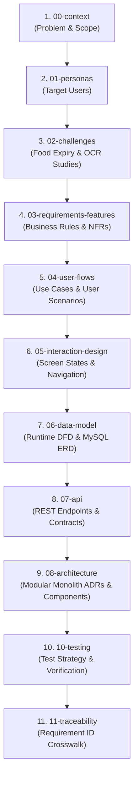

# Expiry System Architecture Documentation

- **Document ID**: `DOC-ARCH-ROOT`
- **Status**: **Active Authority**
- **Updated**: 2026-10-19
- **Current Baseline**: `feature/barcode` (Node.js Express + MySQL 8.4 + Python FastAPI OCR)

Welcome to the centralized architecture documentation for the Expiry platform. This documentation is organized in a hierarchical, multi-tier ranking system reflecting operational truth, functional requirements, and historical provenance.

---

## 1. Document Ranking & Authority Tiers

Documents in this repository are classified into 4 tiers of authority to prevent context drift and clarify implementation truth:

| Tier | Classification | Authority Level | Description | Core Artifacts |
| :---: | :--- | :---: | :--- | :--- |
| **Tier 1** | **Ground Truth & Live Runtime** | ★★★★★ | Strict reflection of active, running codebase, live contracts, and migrations. | `contracts/`, `database/mysql/migrations/`, `DOC-DFD-RUNTIME`, `ADR-001…006`, `components.md`, `endpoints.md` |
| **Tier 2** | **Validated System Specifications** | ★★★★☆ | Core business rules, data dictionaries, use cases, screen matrices, and test suites. | `business-rules.md`, `dictionary.md`, `use-cases.md`, `navigation.md`, `screen-state-matrix.md`, `test-catalog.md` |
| **Tier 3** | **Context & Research Foundations** | ★★★☆☆ | Problem definitions, persona evidence, deep technical research, and traceability registers. | `system-definition.md`, `scope.md`, `P01…P03`, `DEEP_RESEARCH.md`, `id-register.md`, `workstreams.md` |
| **Tier 4** | **Historical Archives & Provenance** | ★★☆☆☆ | Point-in-time Google Doc extractions, rejected proposals, and superseded drafts. | `consolidated/`, `unsupported-proposals.md`, historical reconciliation audits |

---

## 2. Master Reading Order & Subsystem Map

Follow this sequential reading order to understand the platform from business purpose to live execution:



---

## 3. Subsystem Index & Detailed Directory Catalog

### 00-context — System Definition & Scope
- [system-definition.md](00-context/system-definition.md): High-level system goals, boundaries, and actors.
- [scope.md](00-context/scope.md): In-scope MVP capabilities vs out-of-scope enterprise/social features.
- [glossary.md](00-context/glossary.md): Canonical domain terminology (Attention, Certainty, Recount, Drift).
- [source-register.md](00-context/source-register.md): Inventory of design inputs and legal/domain sources.

### 01-personas — Target Audiences
- [P01-persona.md](01-personas/P01-persona.md): Primary household manager / meal planner.
- [P02-persona.md](01-personas/P02-persona.md): Single busy professional / bulk shopper.
- [P03-persona.md](01-personas/P03-persona.md): Minimalist / low-waste lifestyle advocate.
- [persona-comparison.md](01-personas/persona-comparison.md): Feature matrix and pain point intersection across personas.

### 02-challenges — Domain Evidence & Research Spikes
- [food-expiry.md](02-challenges/food-expiry.md): Food shelf-life semantics, expiration labeling standards (Use-by vs Best-before).
- [DEEP_RESEARCH.md](02-challenges/DEEP_RESEARCH.md): Analysis of OCR challenges on curved, reflective, or compressed packaging.
- [ocr-research-v2.md](02-challenges/ocr-research-v2.md): Benchmark comparing Tesseract, DateReg, and Vision LLM fallbacks.

### 03-requirements-features — Formal Requirements
- [business-rules.md](03-requirements-features/business-rules.md): **[Tier 2 Authority]** Invariants on date certainty, units, and stock non-negativity.
- [system-requirements.md](03-requirements-features/system-requirements.md): System functional specifications.
- [nonfunctional-requirements.md](03-requirements-features/nonfunctional-requirements.md): Performance, offline tolerance, and security constraints.
- [impact-analysis.md](03-requirements-features/impact-analysis.md): Consequence and trade-off ledger across architecture decisions.
- [unsupported-proposals.md](03-requirements-features/unsupported-proposals.md): Deprecated proposals (OCR auto-persist, social food sharing).

### 04-user-flows — Use Cases & Scenarios
- [use-cases.md](04-user-flows/use-cases.md): Formal use cases (UC-00 to UC-11) covering Capture, Move, Recount, and Preferences.
- [user-flows.md](04-user-flows/user-flows.md): Step-by-step user interaction journeys.
- [scenarios.md](04-user-flows/scenarios.md): Edge-case scenarios (concurrent edits, network dropouts, unreadable dates).

### 05-interaction-design — Screen Architecture & Transitions
- [navigation.md](05-interaction-design/navigation.md): View hierarchy and modal overlay transitions.
- [screen-state-matrix.md](05-interaction-design/screen-state-matrix.md): Exhaustive matrix of screen states (Loading, Empty, Populated, Error, Offline).
- [sequences.md](05-interaction-design/sequences.md): UI-to-API interaction sequence diagrams.

### 06-data-model — Persistence, ERD & Data Flows
- [runtime-data-flow.md](06-data-model/runtime-data-flow.md): **[Tier 1 Authority]** Level 0-2 DFD, live MySQL store interactions, and dual-axis lifecycle.
- [dictionary.md](06-data-model/dictionary.md): Field-level data dictionary for all database columns and DTOs.
- [erd.md](06-data-model/erd.md): Logical and physical Entity-Relationship Diagrams.
- [entities-and-migrations.md](06-data-model/entities-and-migrations.md): Evolution of MySQL schema migrations (001, 002, 003).

### 07-api — Interface Specifications & Contracts
- [endpoints.md](07-api/endpoints.md): **[Tier 1 Authority]** Detailed catalog of all 17 live REST operations.
- [authentication.md](07-api/authentication.md): Secure HttpOnly cookie, sliding session, and CSRF token architecture.
- [protocol-and-compatibility.md](07-api/protocol-and-compatibility.md): RFC 7807 ProblemDetails specification and versioning rules.

### 08-architecture — System Decisions & Topologies
- [components.md](08-architecture/components.md): **[Tier 1 Authority]** Component ownership and deployment boundary matrix.
- [ADR-001-modular-monolith.md](08-architecture/ADR-001-modular-monolith.md): Architectural Decision Record on Modular Monolith backend.
- [ADR-002-storage-orm.md](08-architecture/ADR-002-storage-orm.md): Direct parameterized SQL with transactional repositories over heavy ORMs.
- [ADR-003-authentication.md](08-architecture/ADR-003-authentication.md): Local credential storage with Argon2id and stateful MySQL sessions.
- [ADR-004-ocr-boundary.md](08-architecture/ADR-004-ocr-boundary.md): Stateless, transient Python microservice for OCR extraction.
- [ADR-006-hybrid-architecture.md](08-architecture/ADR-006-hybrid-architecture.md): Hybrid architecture separating Core Node backend from Python scan.

### 09-advanced-web & 10-testing — Quality & Operations
- [test-catalog.md](10-testing/test-catalog.md): Unit, integration, and E2E test inventory.
- [coverage.md](10-testing/coverage.md): Test coverage requirements across domain, API, and UI components.
- [verification-report.md](10-testing/verification-report.md): Execution records for CI/CD gates.

### 11-traceability & 12-process — Alignment & Standards
- [id-register.md](11-traceability/id-register.md): Master cross-reference mapping Persona $\to$ Requirement $\to$ Use Case $\to$ API Endpoint $\to$ Test Case.
- [gates.md](12-process/gates.md): Phase completion gates and branch merge requirements.

---

## 4. Verification & Audit Tooling
To check local documentation link health and re-index specs:
```bash
# Check link validity across all architectural specs
python3 .tmb/tools/knowledge.py check

# Re-index chunks and local cross-references
python3 .tmb/tools/knowledge.py index
```
